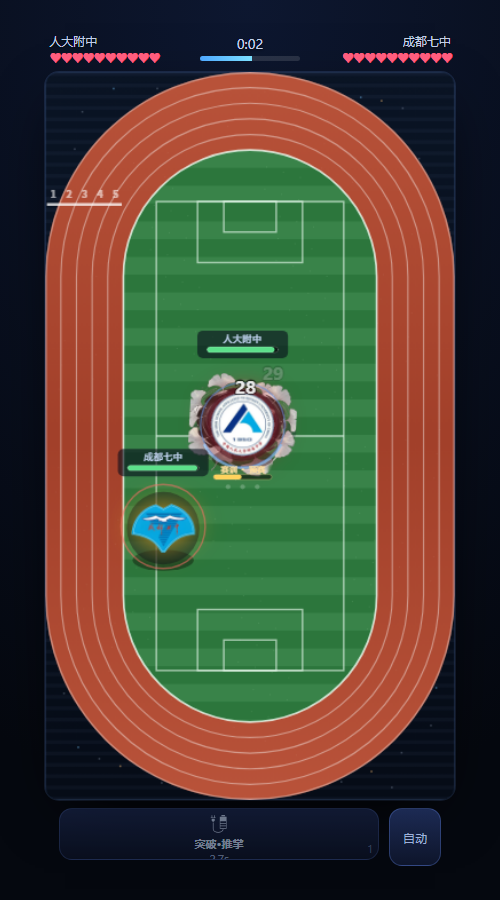

# 谁是最强高中（Who Is The Strongest High School）

> 6 枚校徽 · 5 种流派 · 竖屏 9:16 自动对战小游戏
> 单文件 HTML5 游戏，无需安装、无需联网，手机竖屏即可游玩。



## 玩法

- 选 2 枚校徽（1v1）或 4 枚（2v2）自动对战，也可切手动释放技能
- 每所学校的校徽就是角色，每校只有 1 个专属技能
- 9:16 竖屏操场：纵向 5 条分道红色跑道 + 纵向草坪，红绿面积 1:1
- 心形血条、30 秒加时、校徽图鉴收集、`localStorage` 存档

## 六所学校

| 学校 | 流派 | 技能 |
|---|---|---|
| 人大附中 | 突破流 | **竞赛集训**：赛训条满后突破（50%，失败+25%），三次突破后蓄力重击 + 10 秒伤害 ×2 |
| 衡水中学 | 召唤流 | **你跑不过我你信吗？**：随机 4 个哨子，3 秒后 4×10 学生方阵从最远边角直线冲锋 |
| 成都七中 | 远程输出流 | **墨池**：朝对手当前位置射出慢速墨池，命中减速 50% + 持续伤害，每 3 次攻击打出巨大墨池 |
| 深圳中学 | 远程输出流 | **百课汇流**：课程名文字弹幕，攻速每秒 +50%（仅眩晕可重置），弹幕追踪敌人 |
| 上海中学 | 召唤流 | **龙门楼**：砸向对手 1 秒前的位置（198 伤害 + 眩晕 0.5 秒）；近身自动推开敌人 |
| 华师一附中 | 空投流 | **華·空投**：本体不攻击且免控，沿地上透明「華」字行走，描红后召唤战机空投炸弹 |

## 运行

**方式一：直接打开**

下载 `index.html`，用 Chrome / Edge 双击打开。

**方式二：本地服务器（可选）**

```bash
# 在仓库根目录
python -m http.server 8000
# 浏览器打开 http://localhost:8000
```

**方式三：GitHub Pages**

仓库 Settings → Pages → Deploy from a branch → `main` / `(root)`，
然后访问 `https://<你的用户名>.github.io/<仓库名>/`。

## 项目结构

```
index.html          # 完整游戏（HTML + CSS + JS + SVG 图标 + WebP 素材全部内联）
试玩说明.md          # 详细玩法、素材来源与合规说明
截图/                # 宣传与说明用截图
steam/              # Steam 打包（Electron 包装 + SteamPipe 上传模板）
PUBLISH-GUIDE.md    # GitHub / Steam 发布步骤
```

## 开发说明

- 纯前端单文件：Canvas 2D + 原生 JS（ES5 风格），无构建步骤、无外部依赖
- 世界坐标固定 `506 × 900`（9:16 竖屏），渲染时等比缩放
- 调试入口：`index.html#battle=rdf,qz`（1v1）、`#battle=rdf,hs,qz,sz`（2v2）、`#select`、`#gallery`
- 平衡仿真：`Battle` 可脱离 DOM 运行（Node + `vm`），便于批量对局统计

## 素材与授权（重要）

- **代码**：MIT License，见 [LICENSE](LICENSE)
- **技能图标**：[game-icons.net](https://game-icons.net)，CC BY 3.0，作者 Lorc / Delapouite，游戏内页脚已署名
- **校徽**：6 所学校真实校徽，版权归各校所有，仅作同人演示，**未获授权**
- **AI 图片**：墨池、龙门楼、華字、战机、弹坑来自用户提供的 AI 生成图（豆包），已裁切去背内联
- 详细说明见 [NOTICE-assets.md](NOTICE-assets.md)

> ⚠️ 本项目是**非商业同人 demo**。若要上架 Steam 或公开传播，请先阅读 `PUBLISH-GUIDE.md` 中的「发布前必须处理的知识产权问题」，替换或取得授权后再发布。

## 免责声明

本作角色数值、技能、胜负均为虚构娱乐，不代表真实学校实力；不使用真实师生个人形象；卡面「网传清北人数」为网络统计、非官方数据，仅供娱乐。
